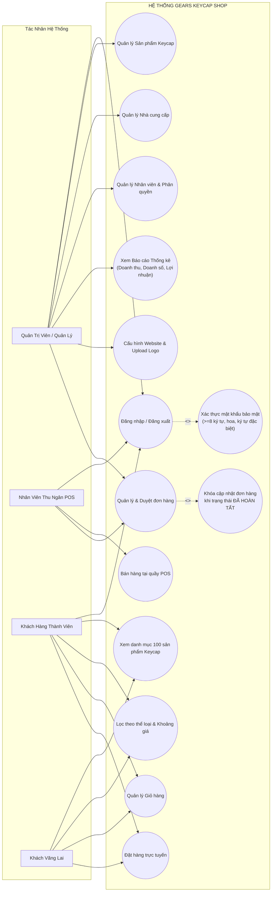
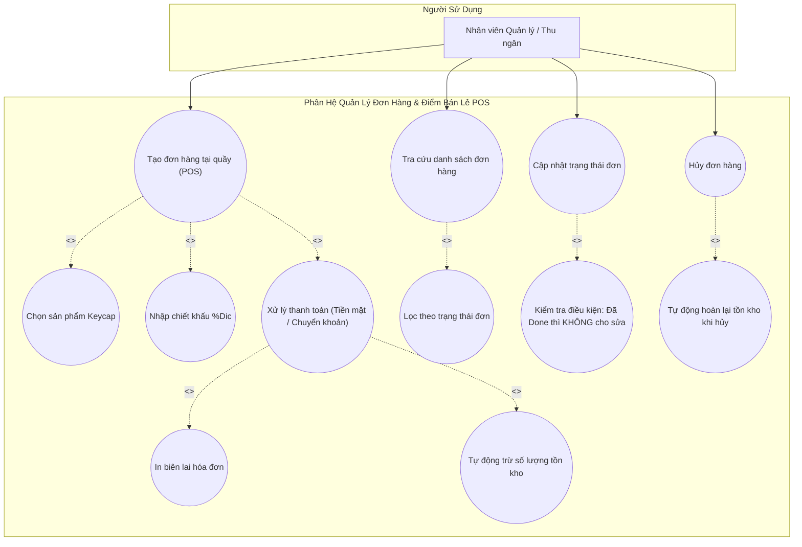
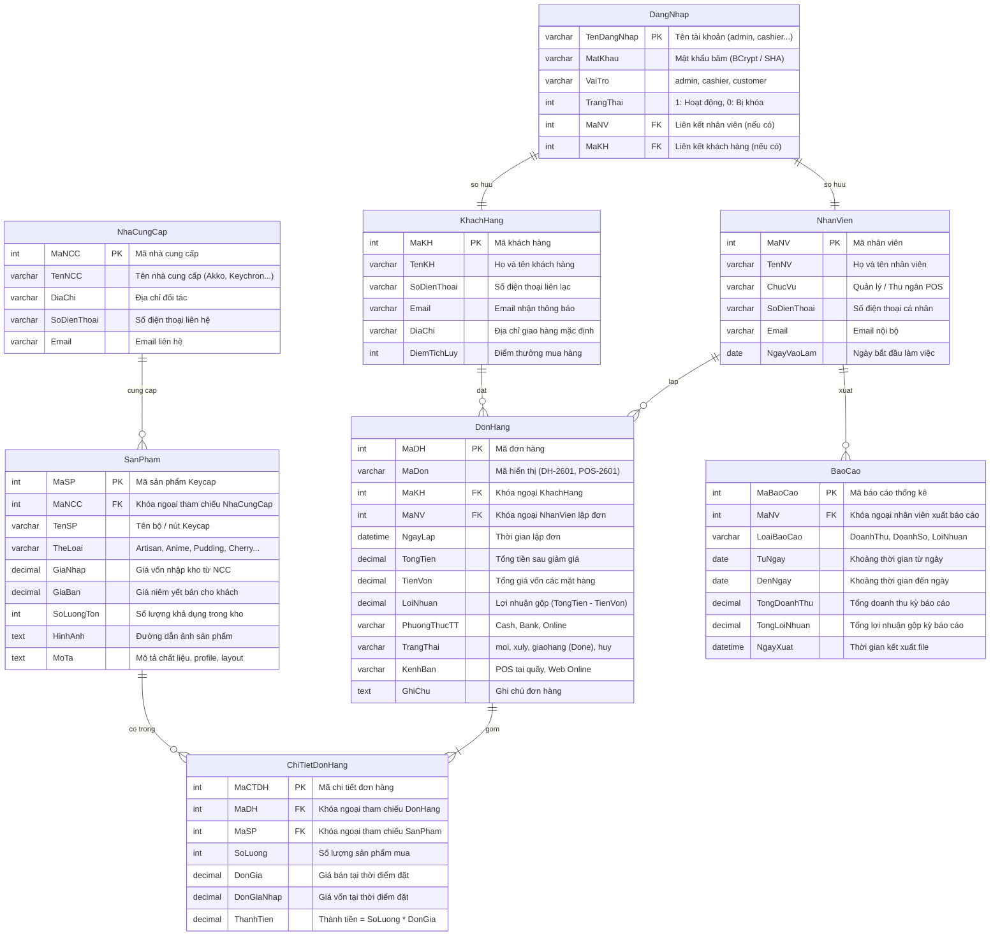
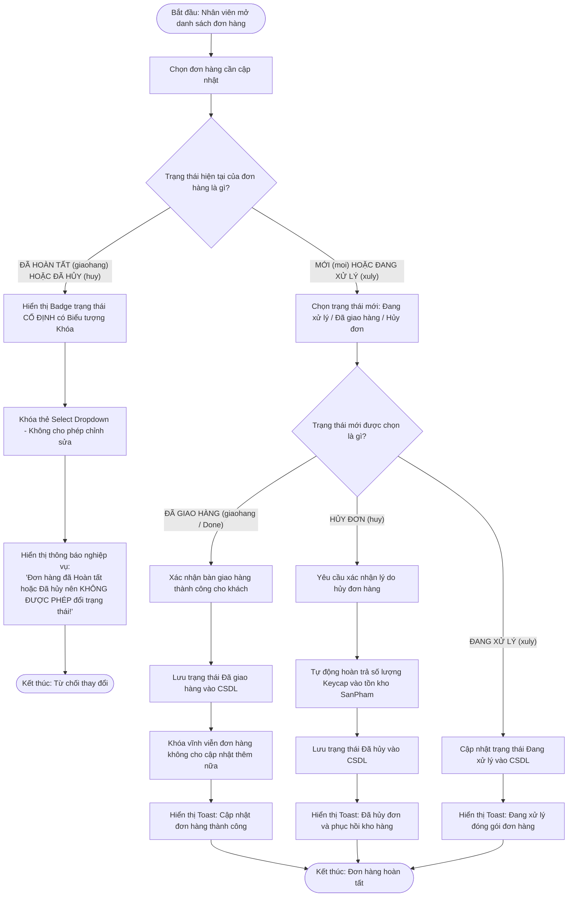
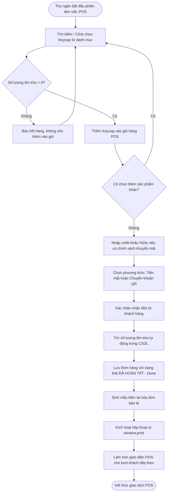
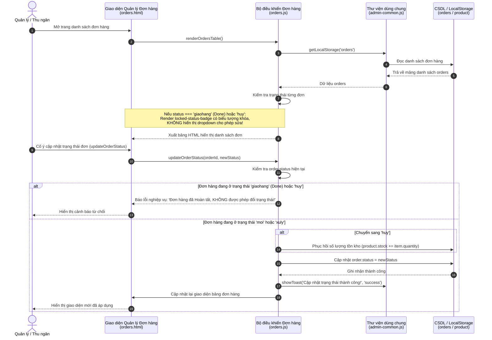
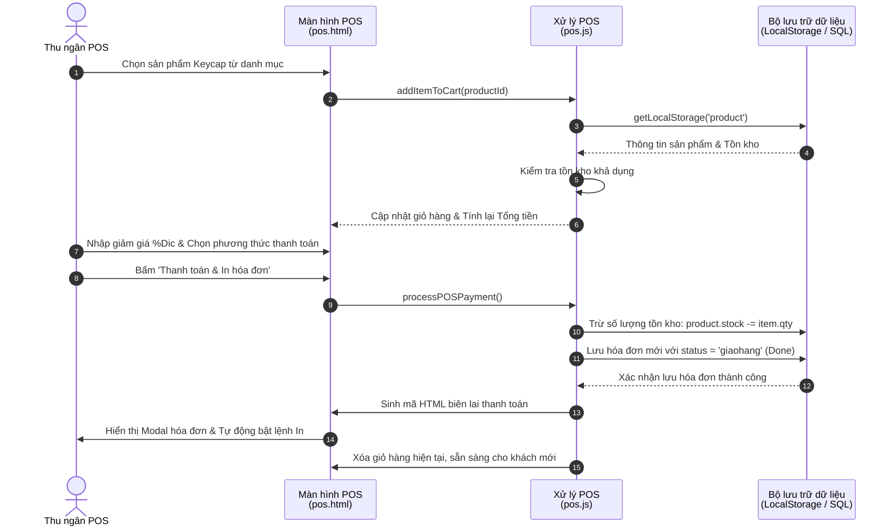
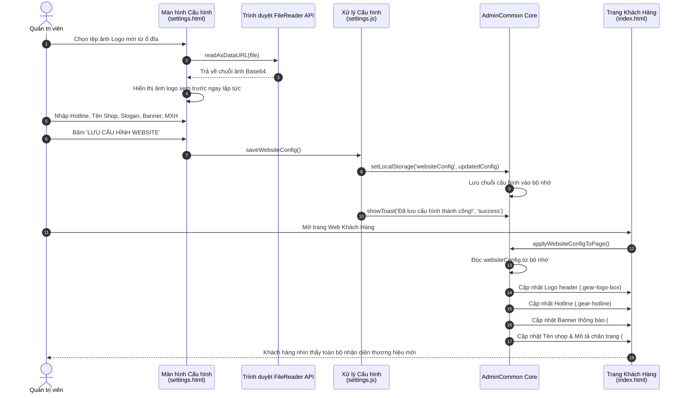
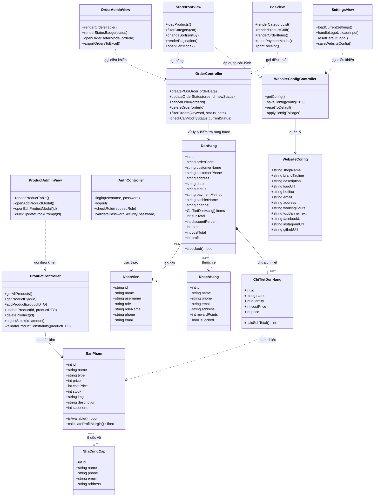

# TRƯỜNG ĐẠI HỌC SÀI GÒN - KHOA CÔNG NGHỆ THÔNG TIN
## BÁO CÁO ĐỒ ÁN MÔN HỌC: PHÂN TÍCH THIẾT KẾ HƯỚNG ĐỐI TƯỢNG (PTTKHDT)
### TÀI LIỆU THIẾT KẾ HỆ THỐNG VÀ CÁC SƠ ĐỒ UML CHUẨN
### ĐỀ TÀI: HỆ THỐNG QUẢN LÝ CỬA HÀNG BÁN KEYCAP (GEARS KEYCAP SHOP)

---

### THÔNG TIN DỰ ÁN & NHÓM THỰC HIỆN
- **Đơn vị đào tạo:** Khoa Công nghệ Thông tin - Trường Đại học Sài Gòn (SGU)
- **Môn học:** Phân tích Thiết kế Hướng đối tượng (PTTKHDT)
- **Hệ thống phát triển:** GEARS Keycap Shop (Quản lý cửa hàng bán Keycap & Điểm bán lẻ POS)
- **Thành viên nhóm:**
  1. **Nguyễn Công Danh** - MSSV: **3124410032** (Trưởng nhóm / Backend & BFD Lead)
  2. **Trần Nhật Quang** - MSSV: **3124410293** (Frontend & POS Lead)
  3. **Lê Hoài Lộc** - MSSV: **3122560041** (Database & Tester Lead)

---

## MỤC LỤC TÀI LIỆU
1. **Sơ đồ phân rã chức năng (Business Function Diagram - BFD)**
2. **Sơ đồ Use Case tổng quát (System Use Case Diagram)**
3. **Sơ đồ Use Case chi tiết phân hệ Bán hàng & Duyệt đơn hàng**
4. **Sơ đồ thực thể liên kết (Entity Relationship Diagram - ERD)**
5. **Sơ đồ hoạt động (Activity Diagrams)**
   - Quy trình duyệt và xử lý đơn hàng (Có ràng buộc khóa trạng thái Đã hoàn tất - Done)
   - Quy trình bán hàng tại quầy POS và in hóa đơn
   - Quy trình cấu hình website và tải lên Logo thương hiệu
6. **Sơ đồ tuần tự (Sequence Diagrams)**
   - Tuần tự luồng xử lý đơn hàng và cập nhật tồn kho
   - Tuần tự luồng bán hàng tại quầy POS
   - Tuần tự luồng upload logo và đồng bộ nhận diện website
7. **Sơ đồ lớp chi tiết (Class Diagram - OOP 3 Lớp)**

---

## 1. SƠ ĐỒ PHÂN RÃ CHỨC NĂNG (BFD - BUSINESS FUNCTION DIAGRAM)

Hệ thống được tổ chức thành 7 phân hệ chính tương ứng với tài liệu khảo sát nghiệp vụ và cấu trúc BFD của đề tài, tích hợp thêm phân hệ mở rộng Quản trị Cấu hình Website:

```mermaid
graph TD
    ROOT["HỆ THỐNG QUẢN LÝ CỬA HÀNG BÁN KEYCAP<br>(GEARS SHOP)"]

    ROOT --> F1["1. Phân hệ Đăng nhập & Xác thực"]
    ROOT --> F2["2. Quản lý Nhà cung cấp"]
    ROOT --> F3["3. Quản lý Đơn hàng & POS"]
    ROOT --> F4["4. Quản lý Khách hàng"]
    ROOT --> F5["5. Quản lý Sản phẩm"]
    ROOT --> F6["6. Quản lý Nhân viên"]
    ROOT --> F7["7. Thống kê Báo cáo"]
    ROOT --> F8["8. Cấu hình Website & Logo"]

    F1 --> F11["1.1 Đăng nhập tài khoản"]
    F1 --> F12["1.2 Kiểm tra chuẩn mật khẩu 8+ ký tự"]
    F1 --> F13["1.3 Ghi nhớ phiên làm việc"]
    F1 --> F14["1.4 Đăng xuất hệ thống"]

    F2 --> F21["2.1 Tạo Nhà cung cấp mới"]
    F2 --> F22["2.2 Tra cứu thông tin NCC"]
    F2 --> F23["2.3 Chỉnh sửa thông tin NCC"]
    F2 --> F24["2.4 Xóa NCC (Kiểm tra ràng buộc)"]
    F2 --> F25["2.5 Xuất dữ liệu NCC ra Excel"]

    F3 --> F31["3.1 Điểm bán lẻ POS tại quầy"]
    F3 --> F32["3.2 Chiết khấu giảm giá %Dic"]
    F3 --> F33["3.3 In biên lai hóa đơn"]
    F3 --> F34["3.4 Duyệt đơn hàng Online"]
    F3 --> F35["3.5 Khóa trạng thái đơn khi Đã xong"]
    F3 --> F36["3.6 Hủy đơn và hoàn tồn kho"]

    F4 --> F41["4.1 Tạo Khách hàng mới"]
    F4 --> F42["4.2 Tra cứu hồ sơ khách hàng"]
    F4 --> F43["4.3 Khóa / Mở khóa tài khoản"]
    F4 --> F44["4.4 Quản lý điểm thưởng tích lũy"]
    F4 --> F45["4.5 Xuất danh sách khách ra Excel"]

    F5 --> F51["5.1 Tạo Sản phẩm Keycap mới"]
    F5 --> F52["5.2 Phân loại thể loại (Artisan, Anime...)"]
    F5 --> F53["5.3 Quản lý giá vốn & giá bán"]
    F5 --> F54["5.4 Nhập thêm hàng (+X) và trừ kho (-X)"]
    F5 --> F55["5.5 Xóa sản phẩm (Kiểm tra giao dịch)"]

    F6 --> F61["6.1 Tạo Nhân viên mới"]
    F6 --> F62["6.2 Phân quyền Quản lý / Thu ngân"]
    F6 --> F63["6.3 Cập nhật thông tin nhân viên"]
    F6 --> F64["6.4 Khóa quyền truy cập nhân viên"]

    F7 --> F71["7.1 Thống kê Doanh thu theo ngày/tháng"]
    F7 --> F72["7.2 Thống kê Doanh số & Số lượng bán"]
    F7 --> F73["7.3 Thống kê Lợi nhuận gộp (Doanh thu - Vốn)"]
    F7 --> F74["7.4 Xuất báo cáo tài chính ra Excel"]

    F8 --> F81["8.1 Tải lên Logo thương hiệu (Upload Logo)"]
    F8 --> F82["8.2 Cập nhật Tên cửa hàng & Khẩu hiệu"]
    F8 --> F83["8.3 Quản lý Hotline CSKH & Showroom"]
    F8 --> F84["8.4 Cấu hình liên kết Mạng xã hội"]
    F8 --> F85["8.5 Tùy chỉnh thông báo Top Banner"]
```



---

## 2. SƠ ĐỒ USE CASE TỔNG QUÁT (SYSTEM USE CASE DIAGRAM)



---

## 3. SƠ ĐỒ USE CASE CHI TIẾT PHÂN HỆ ĐƠN HÀNG & POS



---

## 4. SƠ ĐỒ THỰC THỂ LIÊN KẾT (ERD - CROW'S FOOT NOTATION)

Sơ đồ ERD chuẩn hóa bậc 3 (3NF) gồm 8 bảng dữ liệu quan hệ, khớp 100% với tệp kịch bản `database_keycap_shop.sql`:



---

## 5. SƠ ĐỒ HOẠT ĐỘNG (ACTIVITY DIAGRAMS)

### 5.1 Quy trình Duyệt & Xử lý đơn hàng (Có ràng buộc khóa trạng thái Done)



---

### 5.2 Quy trình Bán hàng tại quầy POS và In hóa đơn



---

### 5.3 Quy trình Cấu hình Website & Upload Logo thương hiệu

```mermaid
flowchart TD
    StartCfg([Quản trị viên mở trang Cấu hình Website]) --> LoadCurrent[Hệ thống tải cấu hình hiện tại từ LocalStorage / CSDL]
    LoadCurrent --> EditInfo[Chỉnh sửa Tên shop, Slogan, Hotline, Showroom, MXH]
    EditInfo --> UploadLogoChoice{Có tải lên Logo mới không?}

    UploadLogoChoice -- Có --> SelectFile[Chọn file ảnh từ máy tính (PNG/JPG/SVG/WebP)]
    SelectFile --> CheckSize{Dung lượng file <= 2MB?}
    CheckSize -- Không --> ErrorSize[Báo lỗi: File vượt quá kích thước 2MB cho phép] --> SelectFile
    CheckSize -- Có --> ReadBase64[FileReader đọc file và chuyển đổi sang định dạng chuỗi Base64 DataURL]
    ReadBase64 --> LivePreview[Hiển thị xem trước tức thì trên khung Logo Preview]
    LivePreview --> SubmitSave[Nhấn nút LƯU CẤU HÌNH WEBSITE]

    UploadLogoChoice -- Không --> SubmitSave
    SubmitSave --> ValidateForm{Tên cửa hàng có hợp lệ?}
    ValidateForm -- Trống --> FocusName[Báo lỗi: Tên thương hiệu không được để trống] --> EditInfo
    ValidateForm -- Hợp lệ --> PersistConfig[Lưu đối tượng websiteConfig vào LocalStorage / CSDL]
    PersistConfig --> BroadcastUpdate[Kích hoạt hàm AdminCommon.applyWebsiteConfigToPage]
    BroadcastUpdate --> UpdateClientUI[Header Logo, Hotline, Footer, Banner trên trang Khách hàng được cập nhật đồng bộ]
    UpdateClientUI --> EndCfg([Cấu hình Website hoàn tất])
```

---

## 6. SƠ ĐỒ TUẦN TỰ (SEQUENCE DIAGRAMS)

### 6.1 Tuần tự luồng xử lý đơn hàng và kiểm tra điều kiện Done



---

### 6.2 Tuần tự luồng Bán hàng tại quầy POS



---

### 6.3 Tuần tự luồng Cấu hình Website & Upload Logo Base64



---

## 7. SƠ ĐỒ LỚP CHI TIẾT (CLASS DIAGRAM - OOP 3 LỚP)

Kiến trúc phần mềm được phân tách rõ ràng theo mô hình 3 lớp (Boundary - Controller - Entity/DAO):



---

### 7.1. HIỆN THỰC 4 TRỤ CỘT LẬP TRÌNH HƯỚNG ĐỐI TƯỢNG (OOP PRINCIPLES)

1. **Tính Đóng Gói (Encapsulation):**
   - Mọi thuộc tính dữ liệu trong các lớp Thực thể (`Product`, `Order`, `Customer`, `Employee`) đều được bảo vệ thông qua các trường nội bộ (`_id`, `_price`, `_stock`, `_status`...) và chỉ cho phép truy xuất/thao tác qua các phương thức Getter, Setter và phương thức nghiệp vụ.
   - Cơ chế xác thực dữ liệu được tích hợp trực tiếp trong lớp: `Product.adjustStock(delta)` từ chối trừ hàng nếu tồn kho không đủ (bảo vệ tồn kho không âm); `Order.transitionTo(newStatus)` từ chối chuyển trạng thái khi đơn hàng đã ở trạng thái khóa `giaohang` hoặc `huy`.

2. **Tính Kế Thừa (Inheritance):**
   - Lớp cơ sở `BaseEntity` đóng gói các thuộc tính chung (`id`, `createdAt`, `updatedAt`, `equals()`, `toJSON()`).
   - Lớp trừu tượng `User` kế thừa từ `BaseEntity`, đóng gói các thuộc tính tài khoản người dùng (`name`, `username`, `phone`, `email`, `role`, `status`).
   - Hai lớp thực thể `Customer` và `Employee` kế thừa trực tiếp từ `User`:
     - `Customer` mở rộng thêm điểm thưởng (`rewardPoints`), địa chỉ (`address`), phân hạng thành viên (`getMembershipTier()`).
     - `Employee` mở rộng thêm chức vụ (`position`), phân quyền thao tác (`hasPermission()`).

3. **Tính Đa Hình (Polymorphism):**
   - Phương thức `getRoleName()` và `getRoleBadgeClass()` được khai báo tại lớp cha `User` và được ghi đè (Override) tại các lớp con:
     - `Customer.getRoleName()` trả về "Khách hàng".
     - `Employee.getRoleName()` trả về linh hoạt "Quản trị viên" hoặc "Nhân viên Thu ngân" dựa vào vai trò được cấu hình.
   - Giao diện `PaymentStrategy` định nghĩa phương thức `pay(order, context)`. Các lớp dẫn xuất `VietQRPaymentStrategy`, `CashPaymentStrategy`, và `CardPaymentStrategy` hiện thực đa hình thuật toán thanh toán tương ứng cho từng kênh giao dịch.

4. **Tính Trừu Tượng (Abstraction):**
   - Hệ thống trừu tượng hóa các khái niệm thực tế thành các lớp mô hình: Toàn bộ quá trình tạo đơn hàng, tính chiết khấu, sinh mã Napas QR, và trừ tồn kho được ẩn giấu sau các giao diện điều khiển cấp cao (`OrderService`, `PaymentStrategy`).
   - Tầng Giao diện (Boundary) chỉ tương tác với các phương thức nghiệp vụ rõ ràng mà không cần can thiệp vào cấu trúc chi tiết bên trong.

---

### 7.2. CÁC MẪU THIẾT KẾ HƯỚNG ĐỐI TƯỢNG (DESIGN PATTERNS) ĐƯỢC ÁP DỤNG

1. **Singleton Pattern (Mẫu Khởi Tạo Đơn Lẻ):**
   - Toàn bộ 11 Service điều khiển nghiệp vụ (`StorageService`, `AuthService`, `ProductService`, `CartService`, `OrderService`, `CustomerService`, `SupplierService`, `EmployeeService`, `ReportService`, `ConfigService`, `NotificationService`) đều áp dụng Singleton Pattern với phương thức `getInstance()`. Đảm bảo chỉ tồn tại một thể hiện duy nhất quản lý trạng thái dữ liệu trong suốt vòng đời ứng dụng.

2. **Factory Method Pattern (Mẫu Nhà Máy Khởi Tạo):**
   - Lớp `EntityFactory` cung cấp các phương thức tĩnh: `createProduct()`, `createOrder()`, `createCustomer()`, `createEmployee()`, `createPaymentStrategy()`.
   - Giúp đóng gói toàn bộ logic kiểm tra hợp lệ, gắn giá trị mặc định và khởi tạo đúng loại đối tượng cụ thể mà không làm lộ chi tiết khởi tạo ra bên ngoài.

3. **Strategy Pattern (Mẫu Chiến Lược):**
   - Đóng gói các thuật toán thanh toán vào họ các chiến lược `PaymentStrategy`:
     - `VietQRPaymentStrategy`: Sinh liên kết mã VietQR SePay theo chuẩn ngân hàng Napas, cú pháp chuyển khoản và cơ chế webhook.
     - `CashPaymentStrategy`: Xử lý giao dịch tiền mặt tại quầy POS, kiểm tra tiền khách đưa và tính tiền thối tự động.
     - `CardPaymentStrategy`: Xử lý giao dịch quẹt thẻ qua thiết bị POS Terminal.

4. **Observer Pattern (Mẫu Người Quan Sát - Pub/Sub):**
   - Triển khai trong `StorageService` với cơ chế `subscribe(key, callback)` và `_notifySubscribers(key, data)`. Khi dữ liệu giỏ hàng hoặc đơn hàng thay đổi, các thành phần giao diện đã đăng ký (như biểu tượng giỏ hàng trên Header, bảng danh sách đơn hàng Admin) sẽ tự động cập nhật mà không cần tải lại trang.

5. **Facade Pattern (Mẫu Mặt Tiền Điều Khiển):**
   - Lớp `GearsApp` đóng vai trò là một Master Gateway Facade duy nhất, tập hợp toàn bộ các Service, Domain Models và Design Patterns. Cung cấp một điểm truy cập tập trung duy nhất (`window.GearsApp`) cho tất cả các trang web trong hệ thống.

---

## 8. KẾT LUẬN & ĐÁNH GIÁ MỨC ĐỘ ĐÁP ỨNG ĐỒ ÁN PTTKHDT

1. **Chuẩn mực nghiệp vụ:**
   - Hệ thống thỏa mãn đầy đủ các quy định kiểm tra bảo mật mật khẩu (tối thiểu 8 ký tự, có chữ in hoa và ký tự đặc biệt).
   - Ràng buộc nghiệp vụ trạng thái đơn hàng được bảo vệ chặt chẽ: Khi đơn hàng đã ở trạng thái **ĐÃ HOÀN TẤT (giaohang / Done)** hoặc **ĐÃ HỦY (huy)**, giao diện sẽ tự động khóa chuyển trạng thái và mã nguồn logic sẽ từ chối bất kỳ hành vi thay đổi nào.
   - Thao tác xóa sản phẩm và xóa đơn hàng đều tích hợp cơ chế bảo toàn dữ liệu và toàn vẹn tham chiếu.

2. **Cấu hình thương hiệu & Nhận diện Website:**
   - Cho phép Quản trị viên tùy biến toàn bộ thông tin hệ thống từ Cổng Quản Trị: Tên shop, Slogan, Hotline, Email, Địa chỉ, Mạng xã hội và tải lên tệp ảnh **Logo thương hiệu** (được mã hóa chuỗi Base64 Data URL).
   - Mọi thay đổi cấu hình được đồng bộ tự động tới trang chủ bán hàng của Khách hàng theo thời gian thực.

3. **Mô hình hóa hình thức chuẩn PTTKHDT:**
   - Tất cả 7 dạng sơ đồ (BFD, Use Case tổng quát, Use Case chi tiết, ERD quan hệ, Activity, Sequence và Class Diagram) đều được mô hình hóa theo đúng chuẩn UML và phương pháp phân tích thiết kế hướng đối tượng của Khoa CNTT - Trường Đại học Sài Gòn (SGU).
